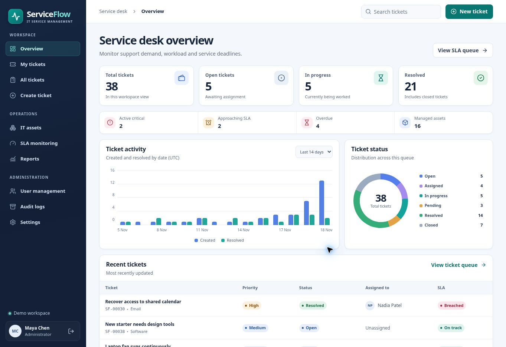
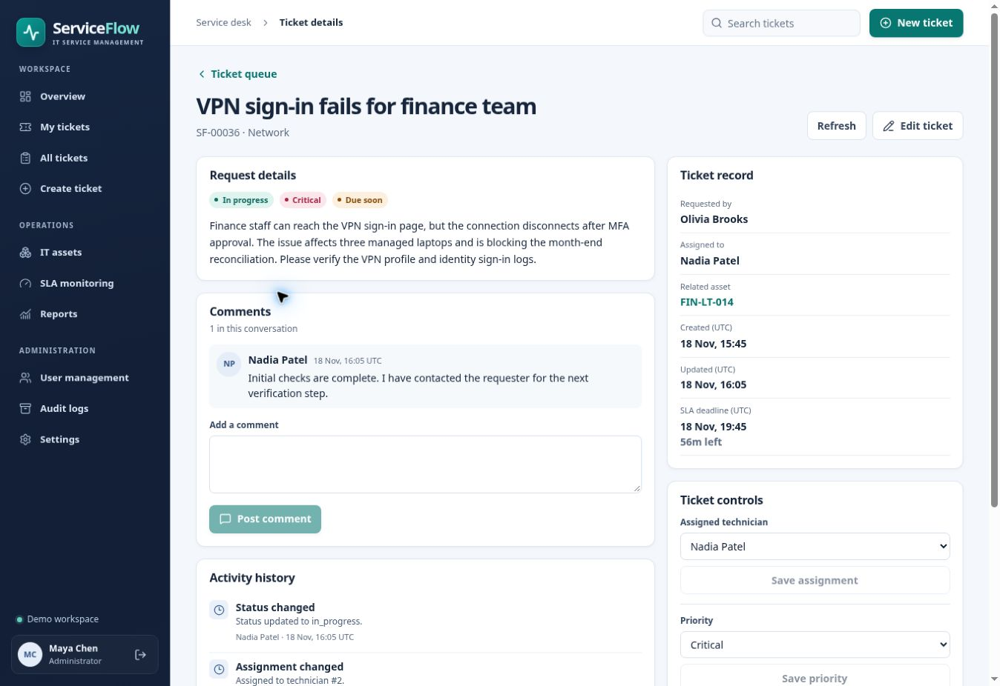
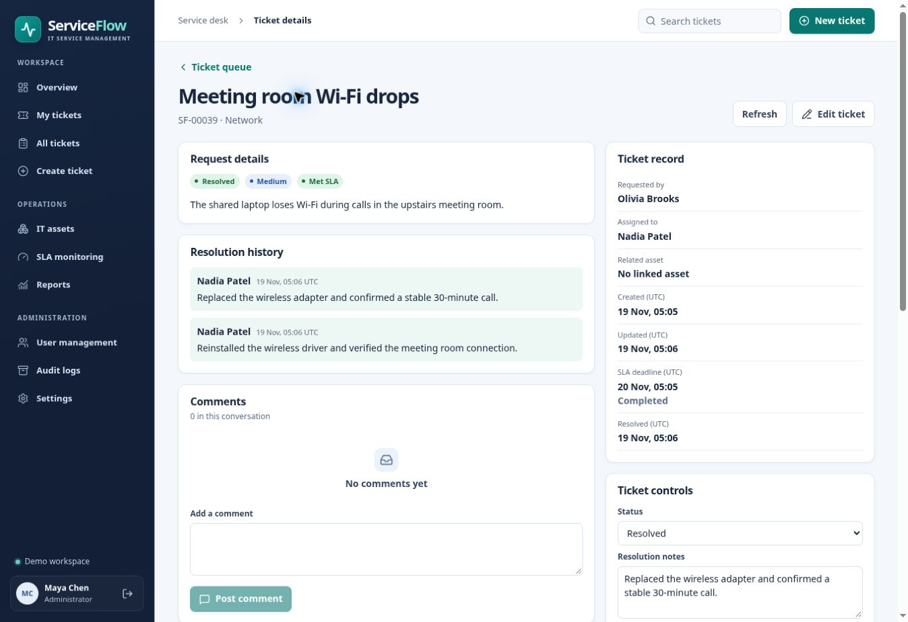
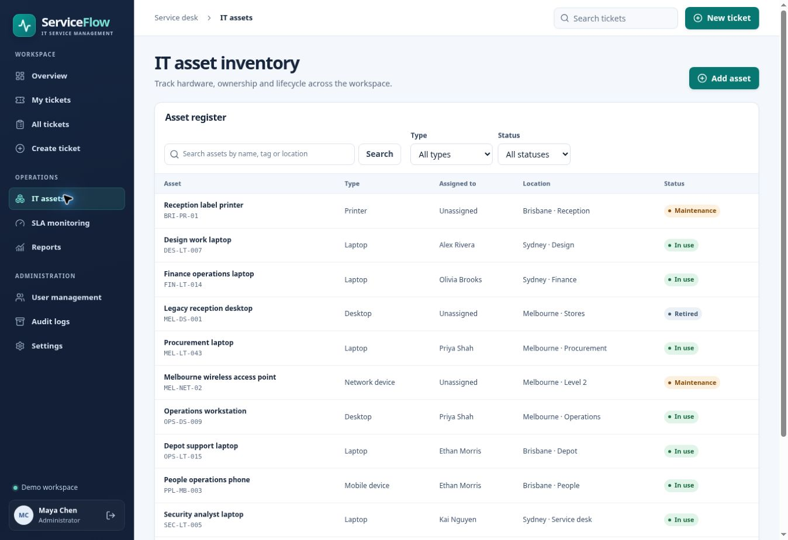
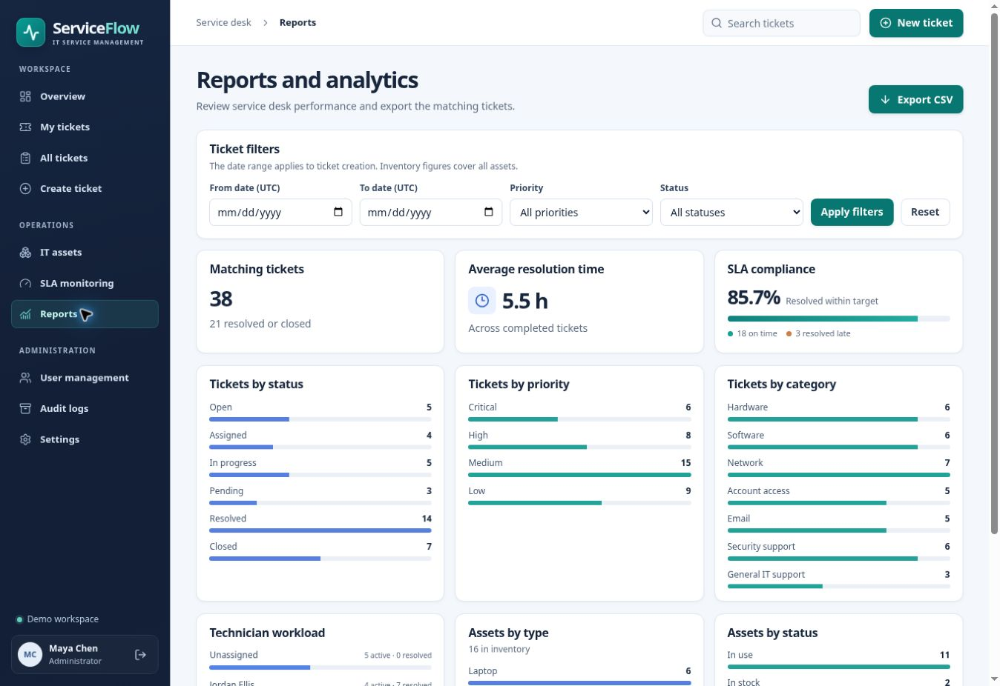

# ServiceFlow

ServiceFlow is a local IT service management application. Employees submit requests, technicians work their assigned queues, and administrators manage assignments, inventory, access and service targets.

Support requests can arrive across inboxes and spreadsheets, leaving a service desk with little visibility into ownership or missed deadlines. ServiceFlow gives each request an owner, a visible workflow, a resolution target and an activity history. It uses fictional demo records so the full workflow can be explored locally.



## Features

| Area | What you can do |
| --- | --- |
| Overview | Inspect queue totals, priority and status distributions, ticket activity, technician workload, SLA compliance and recent requests. Chart controls filter the time range or open the matching queue. |
| Tickets | Create and assign requests, add comments, link assets, and review activity and resolution history. Reopened tickets require new resolution notes. Administrators can archive and restore closed tickets. |
| Inventory | Register assets, assign custodians, manage lifecycle status, and search or filter the register. Asset tags are unique and case-normalised. |
| SLA monitoring | Configure priority targets, review due-soon and overdue tickets, and compare completed work against its deadlines. Visible SLA views refresh every 30 seconds. |
| Reports | Filter by creation date, priority and status. Review resolution time, workload, SLA compliance and inventory distribution. Export matching ticket records to CSV. |
| Administration | Create and maintain staff accounts and inspect audit events. Users can change their own password and sign out. |

## Stack and structure

React, TypeScript, Vite and Tailwind CSS provide the browser interface. FastAPI and Pydantic validate requests and define the REST API. SQLAlchemy persists relational records in SQLite. During development, Vite proxies API requests to FastAPI. The optional container serves the compiled frontend and API from the same origin.

| Path | Contents |
| --- | --- |
| [frontend/src](frontend/src) | React routes, reusable UI, API client and component tests |
| [backend/serviceflow](backend/serviceflow) | FastAPI endpoints, auth, models, SLA policy and fictional fixtures |
| [backend/tests](backend/tests) | Pytest integration tests using temporary SQLite databases |
| [docs/architecture.md](docs/architecture.md) | Request flow, role permissions, state transitions, data model and audit design |
| [docs/screenshots](docs/screenshots) | Screens captured from the running application |
| [frontend/e2e](frontend/e2e) | Browser tests against the built frontend and a real API with a temporary SQLite database |
| [.github/workflows/ci.yml](.github/workflows/ci.yml) | Backend tests on Linux and Windows, frontend checks, build and Chromium browser tests |
| [Dockerfile](Dockerfile) and [docker-compose.yml](docker-compose.yml) | Optional single-origin container with a persistent SQLite volume |

## Run on Windows 11

Install Python 3.11 or newer and Node.js 24 with npm. Node.js 22.12 or newer in the 22.x line also works with the package configuration. Extract the ZIP, open the folder containing this README in File Explorer, press **Alt+D**, type `powershell`, and press **Enter**. Dependencies may need an internet connection on first installation. The running demo uses local services.

### 1. Start the API

Run this in the first PowerShell window. Start from the project folder and keep this window open.

```powershell
cd backend
py -3 -m venv .venv
.\.venv\Scripts\python.exe -m pip install -e ".[dev]"
.\.venv\Scripts\python.exe -m serviceflow seed-demo
.\.venv\Scripts\python.exe -m uvicorn serviceflow.main:app --host 127.0.0.1 --port 8011
```

### 2. Start the frontend

Open a second PowerShell window from the project folder. `npm.cmd` runs npm without changing the PowerShell execution policy.

```powershell
cd frontend
npm.cmd ci
npm.cmd run dev
```

| Open | Address |
| --- | --- |
| ServiceFlow | [http://127.0.0.1:5173](http://127.0.0.1:5173) |
| FastAPI documentation | [http://127.0.0.1:8011/docs](http://127.0.0.1:8011/docs) |
| OpenAPI schema | [http://127.0.0.1:8011/openapi.json](http://127.0.0.1:8011/openapi.json) |
| API health | [http://127.0.0.1:8011/health](http://127.0.0.1:8011/health) |

Press **Ctrl+C** in each PowerShell window to stop the services. Start the API again from the same `backend` folder to reuse its `serviceflow.db` database.

On macOS or Linux, use `python3 -m venv .venv`, invoke `./.venv/bin/python` for the backend commands above and use `npm` in place of `npm.cmd`.

## Demonstration accounts

Choose a role under **Demo accounts** to open the fictional workspace. To test manual sign-in, use one of the emails below and the shared demo password **`ServiceFlowDemo!2026`**. Quick access is enabled only in explicitly seeded workspaces and honours password changes and account restrictions.

| Role | Email | What to try |
| --- | --- | --- |
| Administrator | `admin@serviceflow.test` | Assign a technician, adjust priority, add an asset, change SLA targets and export a filtered report. |
| Technician | `technician@serviceflow.test` | Open **My tickets**, work an assigned ticket, and resolve it with notes. |
| Employee | `employee@serviceflow.test` | Submit a request, link an assigned asset, post a comment and check its status. |

A freshly seeded database contains **38 fictional tickets, 16 assets and 8 accounts**. SLA counts change as deadlines pass. The first seed fills an empty workspace. Re-running the seed preserves its records, and application startup preserves existing data.

To upgrade from v1.0, stop the old API and copy its `backend/serviceflow.db` into the new `backend` folder before launching the API. Startup creates the resolution-history table and imports the latest stored note for tickets with evidence of a prior resolution. Earlier notes that were overwritten in v1.0 are unavailable.

To restore the fictional data, stop the API and run the command below from `backend`. This discards changes in the demo database. The command checks that the database was seeded as a demo.

```powershell
.\.venv\Scripts\python.exe -m serviceflow reset-demo --confirm
```

For an empty workspace with a separate account, point `SERVICEFLOW_DATABASE_URL` at a fresh database filename and run `python -m serviceflow create-admin --name "Local Administrator" --email admin@example.test` using the backend virtual environment. The command prompts twice for a password.

## SLA and reporting rules

The deadline is the ticket creation time in UTC plus its priority target. The default resolution targets are **Critical 4h**, **High 8h**, **Medium 24h** and **Low 72h**. The default due-soon window is two hours. The scheduler uses elapsed time through weekends and Pending status. It runs as calculations at request time.

- An unresolved ticket is overdue once the current time exceeds its deadline. It is due soon when its remaining time is within the configured warning window.
- A completed ticket meets SLA if its latest resolution time is at or before its deadline. Overall compliance is the percentage of completed tickets that met SLA. An unresolved overdue ticket counts towards breaches and enters the compliance denominator when resolved.
- Changing SLA targets preserves stored deadlines. A priority change recalculates the deadline from the original creation time using the current target. Reopening resumes the same deadline, clears the active resolution note, and preserves the previous resolution in history. The next resolution requires a new note.
- Report dates select creation dates inclusively in UTC. Inventory figures describe the whole register. CSV exports include the filtered ticket rows. Archived tickets are excluded from normal queues and reporting.
- Average resolution time is the mean elapsed time from creation to the latest resolution for completed tickets in the filtered set.
- The overview, SLA queue and active ticket countdowns refresh every 30 seconds while their tab is visible. The views also refresh when the tab becomes visible again.

## Configuration and security

Environment variables use the `SERVICEFLOW_` prefix. Copy [backend/.env.example](backend/.env.example) to `backend/.env` only if you need to change defaults. Use an explicit list of allowed browser origins and enable `SERVICEFLOW_COOKIE_SECURE` when serving the app over HTTPS.

The API enforces role checks and scopes ticket and asset queries to the signed-in account. Passwords use Argon2id. Opaque session cookies are HttpOnly and SameSite Strict, and the database stores session digests. Password changes and account restrictions revoke sessions. Write requests with a browser Origin must match the allowlist. The frontend renders user text through React, and the CSV exporter neutralises formula-leading text. Audit records capture actions and affected entities without credentials or session tokens. [OWASP password storage guidance](https://cheatsheetseries.owasp.org/cheatsheets/Password_Storage_Cheat_Sheet.html) · [OWASP request-origin guidance](https://cheatsheetseries.owasp.org/cheatsheets/Cross-Site_Request_Forgery_Prevention_Cheat_Sheet.html)

### Before public hosting

Keep the seeded demo on loopback. For a public deployment, initialise a separate database with `create-admin` and a dedicated password. Demo quick access is available only when the database was seeded for demonstration. Serve the app over HTTPS, enable `SERVICEFLOW_COOKIE_SECURE=true`, set `SERVICEFLOW_ALLOWED_ORIGINS` to the exact HTTPS origins, and enforce login throttling at the gateway before accepting public traffic. [OWASP authentication guidance](https://cheatsheetseries.owasp.org/cheatsheets/Authentication_Cheat_Sheet.html)

## Automated checks

From `backend` in PowerShell:

```powershell
.\.venv\Scripts\python.exe -m pytest
```

From `frontend` in PowerShell:

```powershell
npm.cmd run typecheck
npm.cmd test
npm.cmd run build
```

Backend tests exercise the real API and temporary SQLite databases. They cover sign-in and logout, role scopes, state transitions, inventory constraints, database persistence, SLA boundaries, reporting, CSV output, audit events and invalid inputs. Frontend tests cover filter controls, search, pagination, severity labels and the activity chart. GitHub Actions runs the backend suite on Ubuntu and Windows and builds the frontend on Ubuntu.

To run the browser suite, install the backend and frontend dependencies as above, then run these commands from `frontend` in PowerShell. Playwright starts its own local server and seeds a temporary database for each run. [Playwright web server configuration](https://playwright.dev/docs/test-webserver)

```powershell
npm.cmd exec -- playwright install chromium --only-shell
npm.cmd run test:e2e
```

The browser suite covers sign-in, employee ticket creation, administrator assignment, technician resolution and reopening, role-restricted navigation, SLA refresh during editing, and filtered CSV export. GitHub Actions runs the suite on Ubuntu.

## Optional Docker Compose

From the project folder, with Docker Compose available:

```powershell
docker compose build
docker compose run --rm web python -m serviceflow seed-demo
docker compose up -d
```

Open [http://127.0.0.1:8011](http://127.0.0.1:8011). Both the frontend and API use this address. `docker compose down` stops the service and preserves the named volume.

## More screenshots

### Ticket workflow





### IT asset inventory



### Reports and analytics



## Scope and future improvements

ServiceFlow is a single-workspace IT service management application designed to run locally. SQLite keeps local setup simple and persistent. The ORM leaves room for a PostgreSQL port. Practical extensions include versioned Alembic migrations, identity-provider sign-in, business-hours targets, notifications, and a tamper-resistant audit sink.

Released under the [MIT License](LICENSE).
