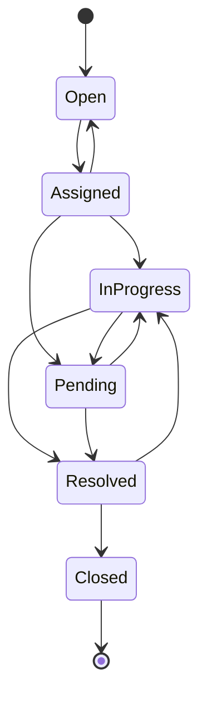

# ServiceFlow architecture

## Application boundaries

The React interface sends same-origin API requests. In development, Vite forwards `/api` and `/health` to Uvicorn. The compiled frontend can also run under FastAPI, which serves the entry page on browser routes. The API validates requests with Pydantic and applies access checks before reading or changing records. SQLAlchemy issues parameterised queries and commits business changes together with their audit events.

| Layer | Main modules | Responsibility |
| --- | --- | --- |
| Browser | `frontend/src/auth.tsx`, `api.ts`, `pages/`, `components/` | Session UI, role-based navigation, REST requests, rendering and forms |
| HTTP | `main.py`, `schemas.py`, `auth.py` | Routing, validation, session cookies, exception handling and origin checks |
| Operations | `tickets.py`, `assets.py`, `admin.py` | Authorised operations, workflow transitions, inventory and staff management |
| Measurements | `analytics.py`, `policy.py` | UTC deadlines, SLA outcomes, dashboard metrics and CSV export |
| Persistence | `models.py`, `db.py`, `seed.py` | Relational models, transactions, foreign keys, demo seeding and reset |

## Role and record scope

| Operation | Employee | Technician | Administrator |
| --- | --- | --- | --- |
| Read tickets | Own requests | Assigned tickets | All current and archived tickets |
| Create tickets | Yes | — | Yes |
| Edit request details | Own open tickets | — | Current tickets before closure |
| Change status and resolution notes | — | Assigned tickets, up to resolution and reopening | Any permitted transition |
| Assign or reprioritise | — | — | Yes |
| Comment | Own current tickets before closure | Assigned current tickets before closure | Current tickets before closure |
| Archive or restore | — | — | Closed tickets |
| Inventory | Link an asset assigned to the requester | Read assets linked to assigned current tickets | Read and manage inventory |
| Account settings | Own password | Own password | Own password, staff administration and SLA policy |
| Reports and audit | — | — | Yes |

The ticket and asset SQL queries include the current user's record scope. Browsing directly to an inaccessible record returns a generic 404, while restricted operations return 403. Tickets carry an incrementing version. The frontend submits that version on changes, and the API rejects stale writes with 409.

## Ticket workflow

Assigning an active technician moves an open ticket to Assigned. Clearing the assignment while the ticket is Assigned returns it to Open. Assigned work needs a technician, and resolution needs notes. Only an administrator can close a ticket. Archiving sets a timestamp on a closed ticket and removes it from current queues and analytics. Restoration clears that timestamp and returns the record to the closed queue.

Each transition into Resolved records the notes, resolver and UTC timestamp in the same transaction as the ticket status. Reopening clears the current note and timestamp while preserving each completed resolution. Edits to the current resolution note update that resolution's record. A new resolution creates a separate record.

Visible SLA views refresh every 30 seconds. Ticket details use a small SLA response with the ticket version, so the refresh can update the countdown without replacing local form drafts.

## Data model

| Table | Key relationships and constraints |
| --- | --- |
| `users` | Unique normalised email, role, password hash and active flag |
| `login_sessions` | Session digest primary key and foreign key to the user, with an expiry timestamp |
| `tickets` | Requester and technician reference users, optional linked asset, status, stored deadline and version |
| `ticket_resolutions` | One row per recorded resolution, with notes, UTC timestamp and references to the ticket and resolver |
| `ticket_comments` | Foreign keys to ticket and author, with comment and timestamp |
| `ticket_activities` | Foreign keys to ticket and actor, with event and timestamp |
| `assets` | Unique normalised tag, asset type and status, with an optional assigned user |
| `audit_logs` | Optional actor foreign key, target type and ID, action, detail and timestamp |
| `workspace` | One row for SLA policy and the demonstration-mode flag |

Timestamps are persisted as UTC and returned with UTC timezone information. SQLite foreign keys are enabled when a connection opens. The API indexes common filters such as assignee, requester, priority, timestamps and audit entity. Audit entries avoid content such as ticket descriptions, comments and authentication credentials. The audit trail lives in the same local database and is appropriate for demonstrating activity review.

## HTTP errors

The API uses 401 for missing or invalid sessions, 403 for forbidden operations, 404 for missing or out-of-scope records, 409 for workflow or uniqueness conflicts, and 422 for invalid input. Validation responses include field locations and messages without submitted values. Database availability errors return 503. The versioned ticket check and per-operation commits maintain a consistent record and activity trail when writes fail.
